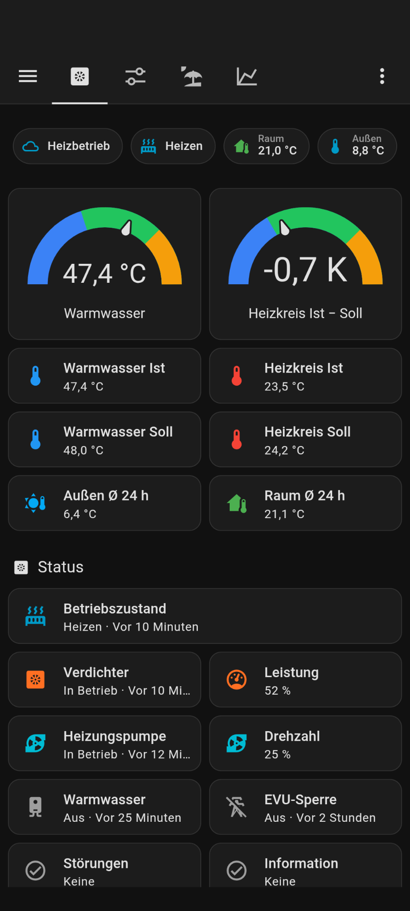
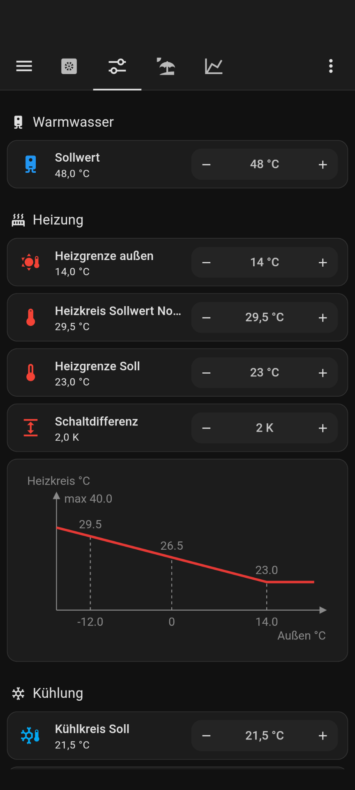
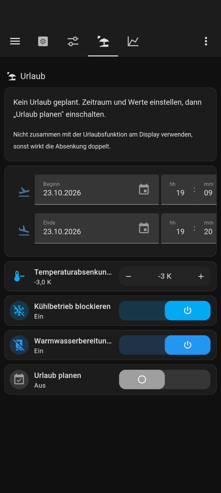
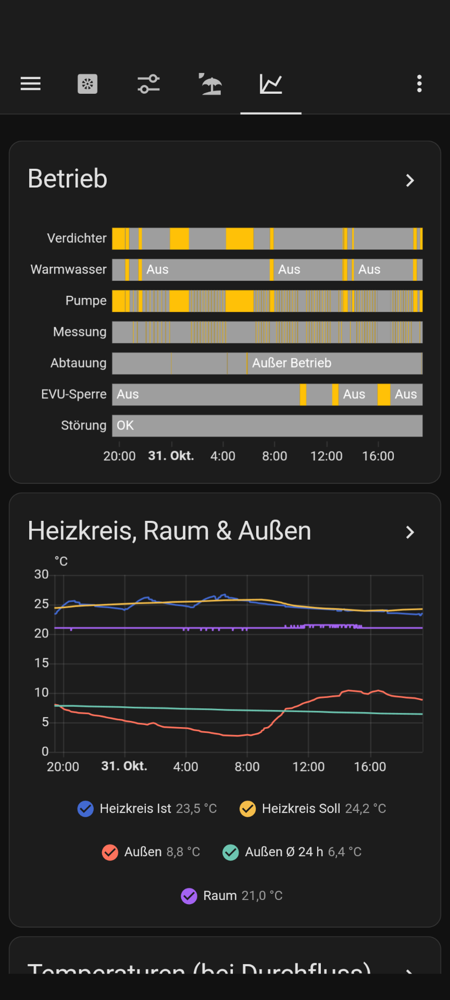

# ha-waterkotte-wwpr

Home Assistant package and dashboard for older **Waterkotte heat pumps with the WWPR controller** (a Carel pCO),
connected through a **Carel pCOWeb** card and Modbus TCP. Waterkotte no longer supports this setup (their way is
EcoTouch + EasyCon), so the register map and behaviour were worked out on a running unit.

> For the newer EcoTouch controllers use [marq24/ha-waterkotte](https://github.com/marq24/ha-waterkotte) instead.

Entity names and the dashboard are German, like the controller's display.

## What you get

- **Status:** compressor, circulation pump, hot water, cooling, EVU lock, operating state ("Heizen",
  "Warmwasser", "EVU-Sperre", …), operating mode as on the display (Heizbetrieb / Neutral / Kühlbetrieb /
  Urlaub), compressor and pump power
- **Temperatures:** outside (now and 24 h mean), flow, return, hot water, heating circuit actual and setpoint.
  The derived values account for how the heat pump works: flow and return only while water flows, spread only
  while heating, defrost and cyclic measurement detected from behaviour.
- **Messages:** active F codes (Störungen) and I codes (Information) as text, plus three checks of its own the
  controller does not do: hot water too cold, heating circuit too cold, EVU lock not ending. You get a
  notification when a fault (Störung) appears and when it is resolved.
- **Settings from Home Assistant:** hot water setpoint, heating curve (with a graph like the display's), heating
  limit, cooling limit and setpoint, hystereses. Every write is checked against the value read back, and changes
  made on the display show up in Home Assistant.
- **Holiday function** like the controller's: lower the heating circuit and block cooling / hot water for a
  planned period, then restore everything. The controller's own holiday function is not reachable via Modbus.
- **Operating hours:** the WWPR's counters stop at 16384 h, so the package counts compressor and pump hours
  itself, plus the runtime per year for heating, hot water and cooling. The long-term statistics keep every
  year, shown as a bar chart.

The dashboard has four tabs: Übersicht, Steuerung, Urlaub, Verlauf.

| Übersicht | Steuerung | Urlaub | Verlauf |
|---|---|---|---|
|  |  |  |  |

The screenshots show the author's dashboard. Its room temperature comes from a separate sensor and is not part of
the package.

## Requirements

- Waterkotte heat pump with WWPR controller and a **Carel pCOWeb** card in the controller's BMS slot ("serial
  card 1"). Used cards work; see [Getting a used pCOWeb card running](https://github.com/irockel/pcoweb-mbproxy/blob/main/docs/pcoweb-card.md).
- **[pcoweb-mbproxy](https://github.com/irockel/pcoweb-mbproxy) on the card – strongly recommended.** With the
  card's stock software (`pcod`), reading works (the package bridges its dropouts), but writes are often
  acknowledged and then not applied.
- Home Assistant with packages enabled. The Modbus integration is built in.

Tested with WWPR firmware 01.05.04. Other firmware versions may use a different register map, so compare
[docs/registers.md](docs/registers.md) with your display before allowing writes.

## Setup

1. **Controller:** in the menu Kommunikation → BMS-Karte 1 set the protocol to **Modbus Slave** and the address
   to **32** (turn "Speichern" on, otherwise the menu forgets the change).
2. **pCOWeb card:** install pcoweb-mbproxy with the
   [WWPR example configuration](https://github.com/irockel/pcoweb-mbproxy/tree/main/examples/waterkotte-wwpr).
   Its write allowlist contains exactly the registers this package writes, with sensible value ranges.
3. **Package:** enable packages in `configuration.yaml` (if not done yet)

   ```yaml
   homeassistant:
     packages: !include_dir_named packages
   ```

   and copy [packages/waterkotte_wwpr.yaml](packages/waterkotte_wwpr.yaml) to `config/packages/`. In it:
   - `modbus` → `host`: the address of your pCOWeb card
   - `script.wp_benachrichtigen`: where messages go. By default they appear as notifications in Home
     Assistant; the comment above the script shows how to send them to your phone instead.
4. **Restart Home Assistant** and check that `sensor.warmepumpe_aussentemperatur` shows the value from the
   display.
5. **Dashboard:** Settings → Dashboards → Add dashboard (from scratch), URL `waerme-pumpe`, then open it → ✏️ →
   ⋮ → Raw configuration editor, and paste [dashboard/waermepumpe.yaml](dashboard/waermepumpe.yaml).
6. **Operating hours (optional):** the counters start at 0. To continue from the display's value, tap
   "Außengerät gesamt" / "Heizungspumpe gesamt" in the Verlauf tab and enter the current hours.

Optional, to keep the database small:

```yaml
recorder:
  exclude:
    entities:
      - sensor.wp_statusblock
      - sensor.wp_leistungsblock
```

## How writes work

All writes go through `script.wp_register_schreiben`: write the register, wait up to 30 s for the read-back,
write once more if it did not arrive, then report success or failure (`input_text.wp_schreibstatus`, plus a
notification on failure). The settings on the Steuerung tab are `input_number` helpers. A change is written 10 s
after the last adjustment if it differs from the heat pump's value. Values changed on the display are copied
into the helpers without writing.

Registers written: A38 (hot water setpoint), A61, A92–A94 (heating), A107–A109 (cooling), I31/I32 (BMS switches
for cooling / hot water, holiday function only). **I30 (heating) is never written** – 0 would switch heating off.

## Notes

- The package's helpers (`input_number.wp_*`, …) also show up in Home Assistant's auto-generated overview
  dashboard. Hide them there or use your own default dashboard.
- Don't use the holiday function in Home Assistant together with the one on the display, or the lowering
  applies twice.
- Waterkotte's register documentation and the FHEM module `98_ModbusWWPR` ([FHEM forum
  thread](https://forum.fhem.de/index.php?topic=52864.0)) were the starting point for the register map.

More: [register map](docs/registers.md) · [observed behaviour](docs/behaviour.md)

## Disclaimer

This writes to a heating system. Wrong values can switch functions off or harm the installation, and writing
parameters often wears the controller's memory. Use at your own risk; check every register against your display
before allowing writes. Not affiliated with Waterkotte or Carel.

## License

[Apache License 2.0](LICENSE)
